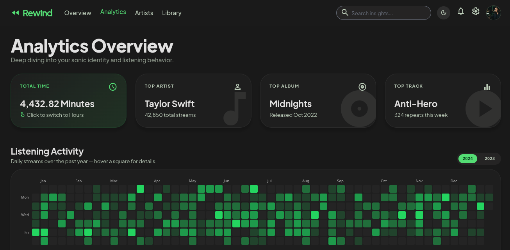

# 🎵 Rewind

**Private, deep analytics for your whole Spotify listening history.**

Spotify Wrapped covers one year. Rewind reads your complete **Extended Streaming
History** export and turns it into:
- an overview with an activity heatmap;
- ranked charts with year-over-year movement and a shareable story-card deck;
- an eleven-chapter deep dive covering when you listen, your sound, your taste, your
  habits, discovery and more.



## How it works

```
React SPA (Vite, TypeScript)  ──/api──▶  FastAPI  ──▶  one DuckDB file per guest session
                                             │
                                             └──▶  45M-track catalog (read-only Parquet) for audio features & genres
```

- **No accounts.** Each browser gets a random session ticket. Your data sits in its own
  database file. It's deleted after 48 hours idle, or right away when you click
  **Delete my data**.
- **Catalog optional.** Without the catalog (`data/metadata/catalog_sorted.parquet`),
  audio features, genres and eras are skipped. Everything history-based still works.
- **Covers** come from Spotify's public oEmbed endpoint, which needs no API key. Set
  `REWIND_COVERS_ENABLED=false` to turn that off.

## Quick start

Requirements: Python 3.13 with [uv](https://docs.astral.sh/uv/), and Node 22.

```bash
make dev        # API on :8000 + web app on http://localhost:5173
```

That's the same as running `make api` and `make web` in two terminals. For sample data,
run `cd backend && uv run python scripts/make_sample_export.py sample` and upload the
two files it writes.

### Docker

```bash
docker compose up --build    # http://localhost
```

One image serves the API and the built SPA. To enable enrichment, put the catalog in
`data/metadata/`.

## Development

| | |
|---|---|
| `make test` | Backend pytest + frontend Vitest |
| `make lint` | ruff, mypy, oxlint, tsc |
| `make types` | Regenerate the frontend API types from the backend's OpenAPI schema |
| `cd frontend && npm run e2e` | Playwright end-to-end suite |

## Docs

- [Frontend](docs/FRONTEND.md)
- [Backend](backend/README.md)
- [API contract](docs/API_CONTRACT.md)
- [Architecture and roadmap](docs/ARCHITECTURE.md)
- [Design system](docs/design.md)
- [UI guidelines](docs/UI_GUIDELINES.md)
- [Data schema](docs/SCHEMA.md)
